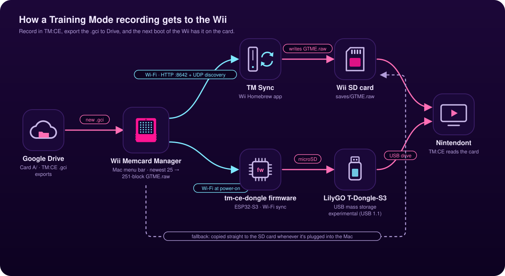

# tm-ce-dongle



Firmware for the LilyGO T-Dongle-S3 that turns it into a USB drive for Nintendont, built so it can
later sync the Training Mode CE save (`saves/GTME.raw`) over Wi-Fi before the Wii sees the drive.

## Milestone 2: Wi-Fi save sync at boot
At power-on, before the Wii sees the drive, the dongle mounts its card, reads `CONFIG/config.txt`,
joins Wi-Fi, finds the TM Sync server (UDP discovery, or `HOST=`), and downloads `saves/GTME.raw`
only if it changed (ETag / `If-None-Match`). Downloads are verified (size + CRC32), installed via
temp file + rename, and the previous card is kept as `saves/GTME.bak`. Any failure just boots with the
card untouched. Each boot appends a line to `CONFIG/sync_log.txt`.

The card must be **FAT32** (the ESP32 FAT library has exFAT disabled).

`CONFIG/config.txt`:
```
SSID=your network
PASSWORD=your password
# optional:
# HOST=192.168.1.20   (skip discovery)
# PORT=8642
# GAME=GTME
# SYNC=false          (disable sync, plain USB drive)
```

Server: Wii Memcard Manager's TM Sync server, or for testing `node tools/tmsync-server.mjs /path/to/GTME.raw`.

## Milestone 1: plain USB drive
The dongle's microSD is presented to the host as a USB mass-storage drive. No Wi-Fi yet. The goal is
to find out whether TM-CE plays acceptably from it through regular Nintendont, since the ESP32-S3 is USB 1.1 (full-speed) only.

Build: `arduino-cli compile --fqbn "esp32:esp32:esp32s3:USBMode=default,CDCOnBoot=default,FlashSize=4M" --export-binaries --output-dir out .`
(ESP32 Arduino core 3.3.x). Flash `out/tmce_dongle.ino.merged.bin` at offset 0x0.

Based on LilyGO's `examples/usb_mass_storage` (MIT).
